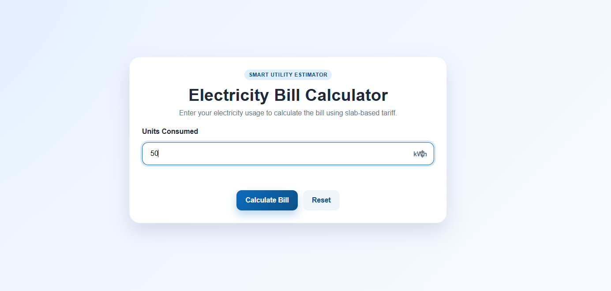
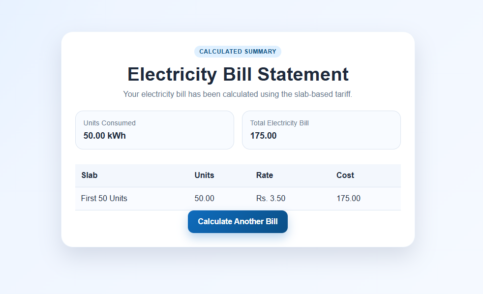

# ⚡ Electricity Bill Calculator

<p align="center">
  
</p>

<p align="center">
  
</p>

A responsive **Electricity Bill Calculator** developed using **JSP, HTML5, CSS3, and JavaScript**, designed to run on **Apache Tomcat 9**.

The application calculates an electricity bill using a slab-based tariff and performs the final calculation **server-side using JSP/Java**.

------------------------------------------------------------------------

## 📌 Project Overview

This project was developed as a JSP-based web application for
calculating electricity bills according to the following tariff
structure:

  Units Consumed                         Rate
  --------------------------- ---------------
  First 50 units                Rs. 3.50/unit
  Next 100 units (51--150)      Rs. 4.00/unit
  Next 100 units (151--250)     Rs. 5.20/unit
  Above 250 units               Rs. 6.50/unit

The user enters the number of electricity units consumed, and the
application calculates and displays the bill along with a detailed
breakdown of each applicable slab.

------------------------------------------------------------------------

## ✨ Features

-   Responsive and mobile-friendly interface
-   Simple and clean user interface
-   Server-side bill calculation using JSP/Java
-   Client-side input validation using JavaScript
-   Slab-wise electricity bill breakdown
-   Automatic calculation of the total bill
-   Handles zero and invalid input
-   Detailed result page
-   Runs on Apache Tomcat 9
-   No external frameworks required

------------------------------------------------------------------------

## 🛠️ Technologies Used

-   **JSP (JavaServer Pages)**
-   **Java**
-   **HTML5**
-   **CSS3**
-   **JavaScript**
-   **Apache Tomcat 9**
-   **JDK 26.0.2**
-   **Visual Studio Code**

------------------------------------------------------------------------

## 📂 Project Structure

``` text
ElectricityBillCalculator/
│
├── index.jsp
├── result.jsp
│
├── css/
│   └── style.css
│
├── js/
│   └── script.js
│
└── WEB-INF/
    └── web.xml
```

### File Description

  -----------------------------------------------------------------------
  File                                Description
  ----------------------------------- -----------------------------------
  `index.jsp`                         Main page where the user enters
                                      electricity units

  `result.jsp`                        Receives the input and performs
                                      server-side bill calculation

  `css/style.css`                     Responsive styling and UI design

  `js/script.js`                      Client-side validation and user
                                      interactions

  `WEB-INF/web.xml`                   Web application configuration and
                                      welcome page
  -----------------------------------------------------------------------

------------------------------------------------------------------------

## ⚙️ Electricity Bill Calculation

The application uses progressive slab-based billing.

### 1. First 50 units

``` text
50 × Rs. 3.50
```

### 2. Next 100 units

For units between 51 and 150:

``` text
100 × Rs. 4.00
```

### 3. Next 100 units

For units between 151 and 250:

``` text
100 × Rs. 5.20
```

### 4. Units above 250

``` text
Remaining units × Rs. 6.50
```

The final bill is the sum of all applicable slabs.

------------------------------------------------------------------------

## 🧮 Example

For **500 units**:

``` text
First 50 units
50 × 3.50 = Rs. 175.00

Next 100 units
100 × 4.00 = Rs. 400.00

Next 100 units
100 × 5.20 = Rs. 520.00

Above 250 units
250 × 6.50 = Rs. 1,625.00
```

Therefore:

``` text
Total = 175 + 400 + 520 + 1,625

Total Electricity Bill = Rs. 2,720.00
```

------------------------------------------------------------------------

## 🚀 How to Run the Project

### Prerequisites

Make sure the following are installed:

-   JDK 17 or above
-   Apache Tomcat 9
-   Visual Studio Code

This project was tested with:

``` text
JDK 26.0.2
Apache Tomcat 9.0.120
```

### Step 1: Copy the project

Copy the `ElectricityBillCalculator` folder into the `webapps` directory
of Apache Tomcat 9.

Example:

``` text
apache-tomcat-9.0.120/
└── webapps/
    └── ElectricityBillCalculator/
```

The application folder should directly contain:

``` text
index.jsp
result.jsp
css/
js/
WEB-INF/
```

### Step 2: Start Tomcat

Open PowerShell and navigate to the Tomcat `bin` directory:

``` powershell
cd "C:\path\to\apache-tomcat-9.0.120\bin"
```

Start Tomcat:

``` powershell
.\startup.bat
```

### Step 3: Open the application

Open a browser and visit:

``` text
http://localhost:8080/ElectricityBillCalculator/
```

------------------------------------------------------------------------

## 🖥️ Application Workflow

``` text
User opens index.jsp
        │
        ▼
Enters electricity units
        │
        ▼
Client-side validation
        │
        ▼
POST request
        │
        ▼
result.jsp
        │
        ▼
Server-side JSP/Java calculation
        │
        ▼
Slab-wise bill calculation
        │
        ▼
Total electricity bill
        │
        ▼
Result displayed to user
```

------------------------------------------------------------------------

## 🔐 Validation

The application validates the entered units before calculation.

It handles:

-   Empty input
-   Non-numeric input
-   Negative values
-   Zero units
-   Invalid numeric values

JavaScript performs initial client-side validation, while JSP performs
the final server-side validation and calculation.

------------------------------------------------------------------------

## 📸 Screenshots

### Home Page

The user enters the number of electricity units consumed and clicks
**Calculate Bill**.

### Bill Result

The result page displays the consumed units, applicable tariff slab,
rate, individual slab cost, and total electricity bill.

------------------------------------------------------------------------

## 🎓 Academic Purpose

This project demonstrates the use of:

-   JSP
-   Server-side scripting
-   HTML forms
-   HTTP POST requests
-   Request parameters
-   Java conditional statements
-   Arithmetic operations
-   CSS responsive design
-   JavaScript validation
-   Apache Tomcat deployment

It is suitable as a basic **JSP/Java web development practical or
mini-project**.

------------------------------------------------------------------------

## 👨‍💻 Author

**Electricity Bill Calculator**

Developed as a JSP-based web application using Apache Tomcat 9.

------------------------------------------------------------------------

## 📄 License

This project is intended for educational and academic use.
